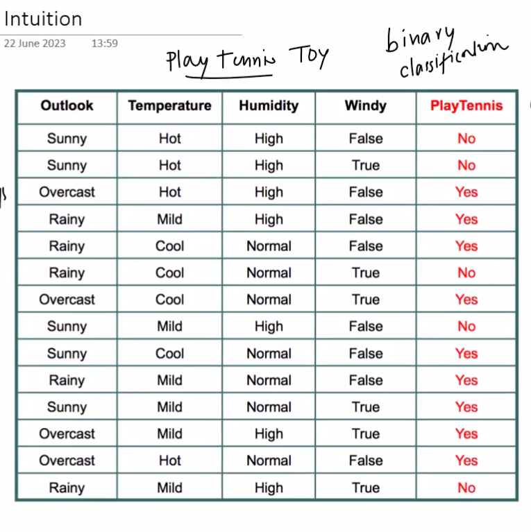
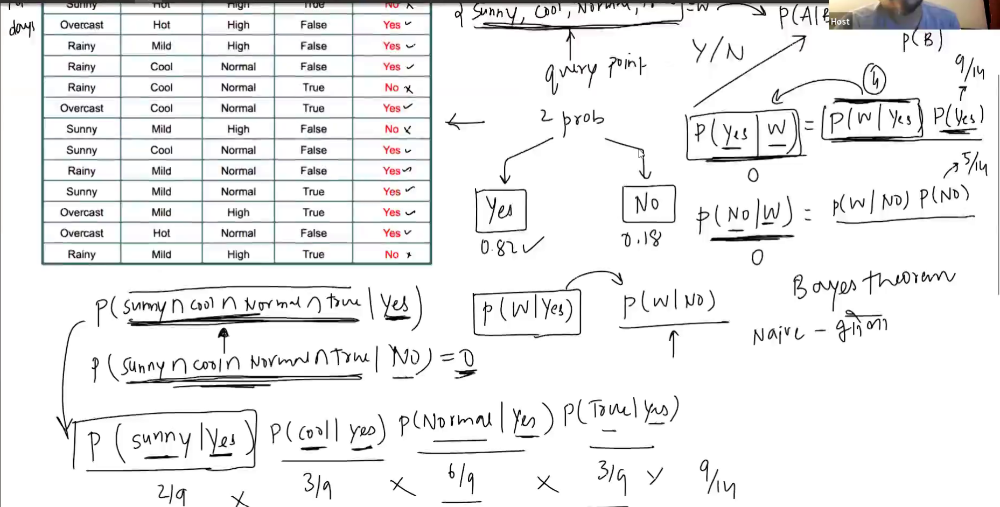
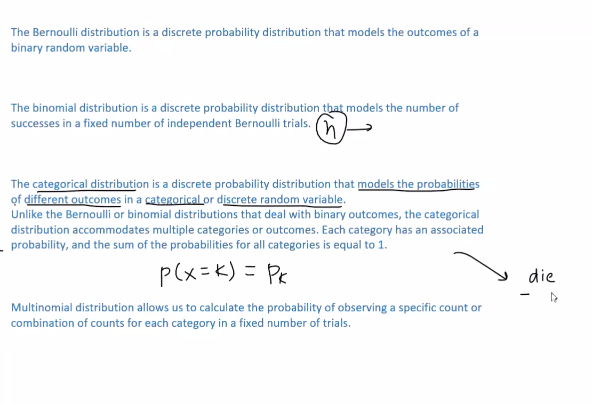
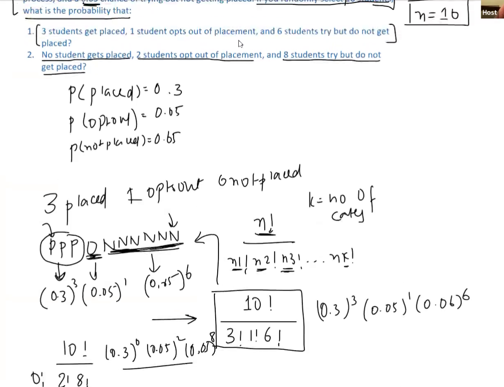

# Naive Bayes-;

## DEFINITION-;
- it works for textual data .
- best examples are spam filters and sentimental analysis

> {width=50}||image row will be -7||

> {width=80}

## CODE EXAMPLE -;

- {width=63}
- {width=65}
